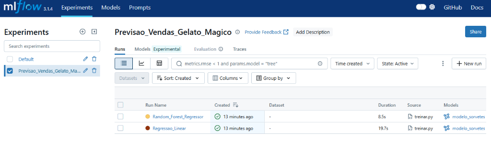

# 🍦 Previsão de Vendas de Sorvete com Machine Learning & MLflow

> Projeto desenvolvido para o desafio **"Treinando seu Primeiro Modelo de Machine Learning para prever Vendas"** da Formação **Microsoft Certified: Azure Data Scientist Associate (DP-100)** na [DIO (Digital Innovation One)](https://dio.me).


---

## 📌 Cenário de Negócio: *Gelato Mágico*

A **Gelato Mágico** é uma sorveteria artesanal localizada em uma cidade litorânea. O proprietário identificou uma forte correlação entre a temperatura ambiente e a quantidade de sorvetes vendidos diariamente.

* **O Desafio:** Produzir sorvete artesanal em excesso gera desperdício de matéria-prima e custos de refrigeração. Por outro lado, produzir de menos em dias de calor extremo acarreta perda direta de receita e insatisfação dos clientes.
* **A Solução:** Criar um modelo preditivo de **Machine Learning (Regressão)** para antecipar a demanda diária com base na previsão do tempo (temperatura) e no calendário (dia de semana vs. fim de semana), permitindo um planejamento cirúrgico da produção.

---

## 🏗️ Arquitetura da Solução

O projeto foi estruturado seguindo as melhores práticas de **MLOps** recomendadas na certificação **DP-100**:

```
dio-agent/
│
├── inputs/
│   └── sorvetes_vendas.csv         # Dataset com histórico de 100 dias (Temperatura x Vendas)
│
├── prints/
│   └── mlflow_dashboard.png        # Evidência do experimento no painel do MLflow
│
├── gerar_dados.py                  # Script reprodutível de geração e modelagem dos dados
├── treinar.py                      # Pipeline de treino, cálculo de métricas e tracking com MLflow
├── prever.py                       # Módulo de inferência em tempo real consumindo o melhor modelo
└── README.md                       # Documentação técnica e insights de negócio
```

---

## 📊 Rastreamento de Experimentos com MLflow

Para garantir governança, rastreabilidade e reprodutibilidade, utilizamos o **MLflow** para gerenciar o ciclo de vida do modelo.

Foram treinados e comparados dois algoritmos de regressão:
1. **Regressão Linear:** Modelo clássico com alta interpretabilidade para relações proporcionais.
2. **Random Forest Regressor:** Modelo baseado em comitê de árvores de decisão.

### Dashboard do MLflow:


### 📈 Comparativo de Performance:

| Algoritmo | $R^2$ Score (Acurácia) | MAE (Erro Médio Absoluto) | RMSE (Raiz do Erro Quadrático) |
|---|---|---|---|
| **Regressão Linear** | **99.57% (0.9957)** | **7.08 unidades** | **8.08 unidades** |
| Random Forest Regressor | 96.98% (0.9698) | 17.87 unidades | 21.51 unidades |

> **Conclusão:** A **Regressão Linear** obteve um desempenho superior, errando em média apenas **~7 sorvetes por dia**, com $R^2$ de 99.57%, sendo promovida como o modelo campeão para produção.

---

## ⚡ Previsões em Tempo Real (`prever.py`)

O módulo [`prever.py`](prever.py) simula o consumo do modelo em produção: ele consulta dinamicamente o experimento no MLflow, identifica o modelo com o maior $R^2$ e executa inferências sob demanda.

### Simulações de Cenários Reais:

```text
=======================================================
[Gelato Magico] - Sistema de Previsao de Vendas (ML)
=======================================================

Previsoes em tempo real geradas pelo modelo:
  * Dia ameno durante a semana (20.0°C | Fim de semana: Não) => Previsão: 139 sorvetes
  * Dia quente durante a semana (28.5°C | Fim de semana: Não) => Previsão: 305 sorvetes
  * Sábado ensolarado e muito quente (33.0°C | Fim de semana: Sim) => Previsão: 435 sorvetes
  * Domingo de calor extremo (38.0°C | Fim de semana: Sim) => Previsão: 533 sorvetes
```

---

## ☁️ Conexão com o Azure Machine Learning (DP-100)

O **Azure Machine Learning** adota nativamente o **MLflow** como padrão para registro e governança. Para executar esse mesmo projeto diretamente na nuvem do Azure, basta conectar a URI de rastreamento do Workspace:

```python
import mlflow
from azure.ai.ml import MLClient
from azure.identity import DefaultAzureCredential

# Autenticação no Azure
ml_client = MLClient(DefaultAzureCredential(), subscription_id, resource_group, workspace_name)

# Aponta o MLflow para registrar as runs direto no Azure ML Studio
mlflow.set_tracking_uri(ml_client.workspaces.get(workspace_name).mlflow_tracking_uri)
```

Dessa forma, todo o código desenvolvido neste repositório é 100% compatível e portátil para o ecossistema Azure.

---

## 🚀 Como Executar o Projeto Localmente

1. **Clone o repositório:**
   ```bash
   git clone https://github.com/SEU-USUARIO/SEU-REPOSITORIO.git
   cd SEU-REPOSITORIO
   ```

2. **Instale as dependências:**
   ```bash
   pip install pandas scikit-learn mlflow
   ```

3. **Gere os dados e treine os modelos:**
   ```bash
   python gerar_dados.py
   python treinar.py
   ```

4. **Abra o painel interativo do MLflow:**
   ```bash
   mlflow ui
   ```
   Acesse: `http://127.0.0.1:5000`

5. **Execute previsões em tempo real:**
   ```bash
   python prever.py
   ```

---

## 💡 Insights e Aprendizados

* **Impacto no Negócio:** Uma redução no erro médio de produção para apenas 7 sorvetes/dia minimiza perdas com insumos perecíveis e maximiza a receita em dias de pico.
* **MLOps na Prática:** O uso do MLflow desacopla o código de treinamento do monitoramento, permitindo versionar modelos e comparar métricas de forma visual e transparente.
* **Portabilidade em Nuvem:** A padronização com MLflow garante que o pipeline possa ser transferido para o Azure ML Studio sem refatoração de código.

---

Desenvolvido com 🍦 e Inteligência Artificial por **Dimas** na formação **DP-100 da DIO**.
